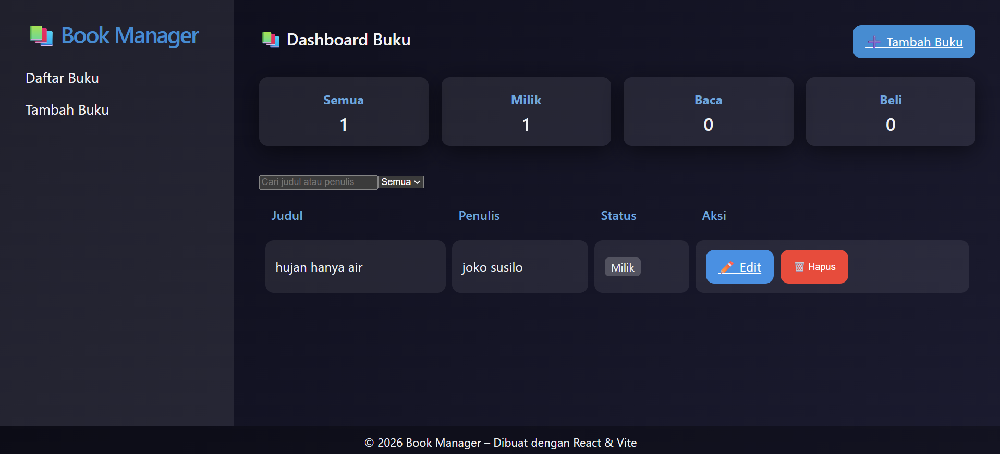

# Book Management App

## Deskripsi Tugas
Aplikasi web sederhana berbasis **React** dan **Vite** untuk mengelola data buku. Fitur utama meliputi:
- Menambah buku baru
- Mengedit data buku yang ada
- Menampilkan daftar buku dalam tampilan dashboard

## Dokumentasi Tugas
Berikut adalah dokumentasi visual dari masing-masing fitur yang telah diimplementasikan.

### Dashboard
Menampilkan daftar semua buku yang telah ditambahkan.

### Tambah Buku
Form untuk menambah data buku baru.

### Edit Buku
Form untuk mengubah data buku yang dipilih.

