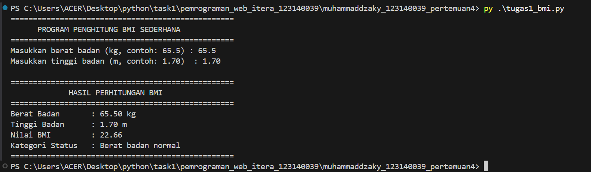
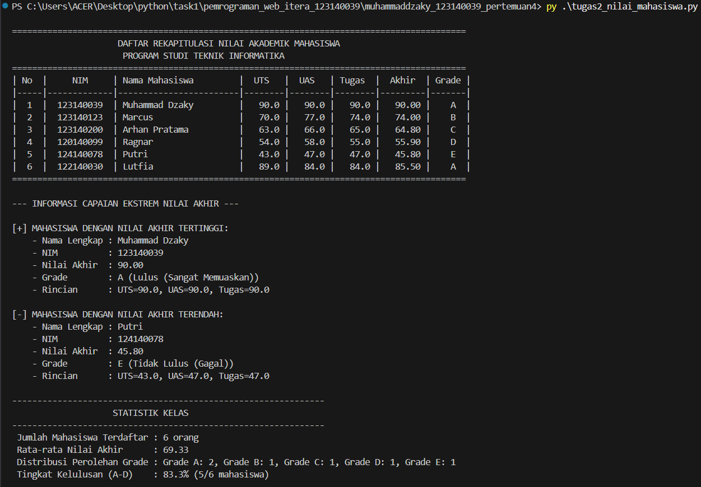
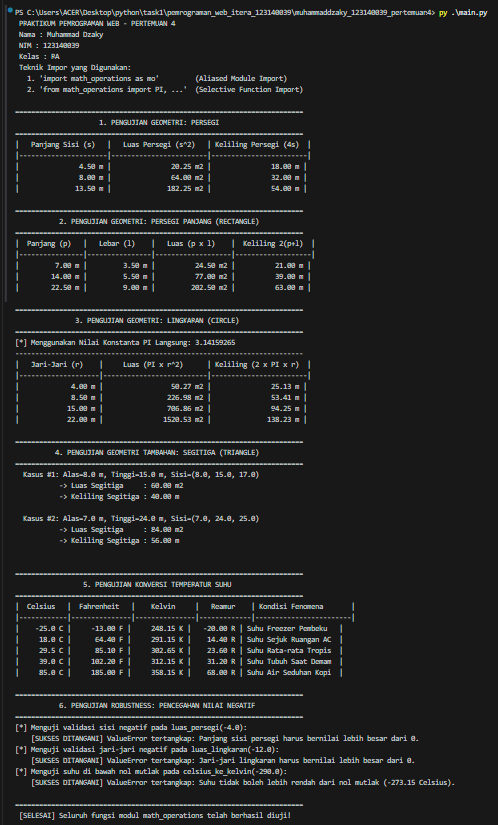

# Tugas Praktikum Pemrograman Web - Pertemuan 4
**Program Studi Teknik Informatika — Institut Teknologi Sumatera (ITERA)**

---

## 📌 Identitas Mahasiswa

| Informasi | Keterangan |
| :--- | :--- |
| **Nama** | Muhammad Dzaky |
| **NIM** | 123140039 |
| **Mata Kuliah** | Pemrograman Web |
| **Praktikum** | Pertemuan 4 (Dasar Pemrograman Python & Modularisasi) |

---

## 📂 Struktur Berkas Proyek

```text
muhammaddzaky_123140039_pertemuan4/
│
├── tugas1_bmi.py             # Skrip Tugas Soal 1 (Kalkulator BMI Sederhana)
├── tugas2_nilai_mahasiswa.py # Skrip Tugas Soal 2 (Pengolahan Rekapitulasi Nilai Mahasiswa)
├── math_operations.py        # Modul Kustom Matematika & Konversi Suhu (Soal 3)
├── main.py                   # Program Utama Demonstrasi Modul math_operations (Soal 3)
├── README.md                 # Dokumentasi Lengkap Tugas Praktikum
├── .gitignore                # Konfigurasi Pengecualian Berkas Git (venv, __pycache__, dll.)
└── Screenshoots/             # Direktori Bukti Hasil Eksekusi Program di Terminal
    ├── tugas1.png            # Screenshot Bukti Eksekusi Soal 1
    ├── tugas2.png            # Screenshot Bukti Eksekusi Soal 2
    └── tugas3.png            # Screenshot Bukti Eksekusi Soal 3
```

---

## 📖 Deskripsi Alur Kerja dan Fungsi Program

### 1. Soal 1: Program Penghitung BMI Sederhana (`tugas1_bmi.py`)

#### A. Alur Kerja:
1. Program menampilkan antarmuka awal dan meminta input berat badan (dalam kilogram / kg) serta tinggi badan (dalam meter / m) dari pengguna.
2. Program melakukan validasi input numerik:
   - Memastikan nilai berupa angka numerik positif (> 0).
   - Menangani error masukan non-angka melalui blok penanganan eksepsi `try-except ValueError`.
3. Menghitung nilai BMI dengan rumus:
   $$\text{BMI} = \frac{\text{berat}}{\text{tinggi}^2}$$
4. Mengklasifikasikan status berat badan berdasarkan acuan standar WHO:
   - $\text{BMI} < 18.5$ : **Berat badan kurang**
   - $18.5 \le \text{BMI} < 25.0$ : **Berat badan normal**
   - $25.0 \le \text{BMI} < 30.0$ : **Berat badan berlebih**
   - $\text{BMI} \ge 30.0$ : **Obesitas**
5. Menampilkan rekapitulasi data input, nilai BMI yang diformat 2 angka di belakang koma (`{bmi:.2f}`), serta kategori status berat badan ke terminal.

#### B. Fungsi yang Digunakan:
- `hitung_bmi(berat: float, tinggi: float) -> float`  
  *Deskripsi*: Menghitung indeks massa tubuh (BMI).  
  *Parameter*: `berat` (float, satuan kg), `tinggi` (float, satuan m).  
  *Return*: `float` (nilai BMI).
- `tentukan_kategori_bmi(bmi: float) -> str`  
  *Deskripsi*: Mengklasifikasikan kategori berat badan berdasarkan nilai BMI.  
  *Parameter*: `bmi` (float, nilai BMI hasil kalkulasi).  
  *Return*: `str` (kategori status berat badan).
- `main() -> None`  
  *Deskripsi*: Fungsi utama yang menangani input interaktif pengguna, validasi, pemanggilan fungsi kalkulasi, dan pencetakan hasil ke terminal.

---

### 2. Soal 2: Pengolahan Rekapitulasi Nilai Mahasiswa (`tugas2_nilai_mahasiswa.py`)

#### A. Alur Kerja:
1. Menyimpan data mentah mahasiswa dalam bentuk sekumpulan kamus (*list of dictionaries*) dengan minimal 5 data mahasiswa yang mencakup `nama`, `nim`, `nilai_uts`, `nilai_uas`, dan `nilai_tugas`.
2. Menghitung Nilai Akhir setiap mahasiswa berdasarkan bobot:
   $$\text{Nilai Akhir} = (30\% \times \text{UTS}) + (40\% \times \text{UAS}) + (30\% \times \text{Tugas})$$
3. Mengonversi nilai akhir menjadi huruf mutu (*Grade*) dan status kelulusan:
   - $\ge 80.0$ : **A** (Lulus - Sangat Memuaskan)
   - $70.0 - 79.9$ : **B** (Lulus - Memuaskan)
   - $60.0 - 69.9$ : **C** (Lulus - Cukup)
   - $50.0 - 59.9$ : **D** (Lulus Bersyarat - Kurang)
   - $< 50.0$ : **E** (Tidak Lulus - Gagal)
4. Menampilkan tabel rekapitulasi data mahasiswa terformat rapi dengan perataan kolom yang teratur (*header, separator line, formatted rows*).
5. Mengidentifikasi mahasiswa dengan capaian nilai akhir tertinggi dan terendah menggunakan fungsi bawaan `max()` dan `min()` dengan *key lambda*.
6. Menghitung dan mencetak wawasan statistik kelas: rata-rata nilai akhir, distribusi frekuensi perolehan tiap grade, dan persentase kelulusan kelas.

#### B. Fungsi yang Digunakan:
- `hitung_nilai_akhir(uts: float, uas: float, tugas: float) -> float`  
  *Deskripsi*: Menghitung nilai akhir tertimbang mahasiswa.  
  *Parameter*: `uts` (float), `uas` (float), `tugas` (float).  
  *Return*: `float` (nilai akhir terbobot).
- `tentukan_grade(nilai_akhir: float) -> Tuple[str, str]`  
  *Deskripsi*: Menentukan huruf mutu dan status kelulusan.  
  *Parameter*: `nilai_akhir` (float).  
  *Return*: `Tuple[str, str]` (grade dan status kelulusan).
- `proses_data_mahasiswa(daftar_raw: List[Dict[str, Any]]) -> List[Dict[str, Any]]`  
  *Deskripsi*: Mengiterasi data mentah mahasiswa dan menghasilkan data lengkap terproses.  
  *Parameter*: `daftar_raw` (list berisi dictionary data mahasiswa mentah).  
  *Return*: `List[Dict[str, Any]]` (daftar mahasiswa terproses).
- `cari_nilai_ekstrem(daftar_data: List[Dict[str, Any]]) -> Tuple[Dict[str, Any], Dict[str, Any]]`  
  *Deskripsi*: Menemukan entri mahasiswa dengan nilai akhir tertinggi dan terendah.  
  *Parameter*: `daftar_data` (list data mahasiswa terproses).  
  *Return*: `Tuple[Dict[str, Any], Dict[str, Any]]` (pasangan dictionary mahasiswa tertinggi dan terendah).
- `cetak_tabel_mahasiswa(daftar_data: List[Dict[str, Any]]) -> None`  
  *Deskripsi*: Mencetak tabel rekapitulasi nilai akademik ke terminal.  
  *Parameter*: `daftar_data` (list data mahasiswa terproses).
- `cetak_sorotan_ekstrem(tertinggi: Dict[str, Any], terendah: Dict[str, Any]) -> None`  
  *Deskripsi*: Menampilkan informasi detail peraih nilai tertinggi dan terendah.  
  *Parameter*: `tertinggi` (dictionary data mahasiswa tertinggi), `terendah` (dictionary data mahasiswa terendah).
- `cetak_ringkasan_statistik(daftar_data: List[Dict[str, Any]]) -> None`  
  *Deskripsi*: Menghitung dan menampilkan rata-rata kelas, distribusi grade, serta persentase tingkat kelulusan.  
  *Parameter*: `daftar_data` (list data mahasiswa terproses).
- `main() -> None`  
  *Deskripsi*: Fungsi pengontrol utama alur eksekusi program.

---

### 3. Soal 3: Modul Geometri, Konversi Suhu, dan Program Utama (`math_operations.py` & `main.py`)

#### A. Alur Kerja:
1. Pembuatan modul kustom `math_operations.py`:
   - Menyediakan konstanta `PI` dan `EULER`.
   - Menyediakan fungsi perhitungan geometri bidang datar (persegi, persegi panjang, lingkaran, dan segitiga).
   - Menyediakan fungsi konversi temperatur suhu antar-satuan (Celsius, Fahrenheit, Kelvin, Reamur).
   - Menerapkan *defensive programming* dengan memvalidasi parameter non-negatif atau di atas batas fisik suhu (*absolute zero* $-273.15^\circ\text{C}$).
   - Memiliki blok pengujian mandiri (*self-testing*) melalui idiom `if __name__ == "__main__":`.
2. Program pemanggil `main.py`:
   - Mengimplementasikan dua teknik impor modul Python:
     1. **Aliased Module Import**: `import math_operations as mo`
     2. **Selective / Direct Function Import**: `from math_operations import PI, luas_lingkaran, ...`
   - Menguji dan menyajikan hasil perhitungan geometri dalam bentuk tabel terformat.
   - Menguji konversi suhu menggunakan berbagai sampel temperatur kontekstual sehari-hari.
   - Menguji keandalan penanganan kesalahan (*error handling*) terhadap input nilai negatif melalui blok `try-except ValueError`.

#### B. Fungsi pada Modul `math_operations.py`:
- `luas_persegi(sisi: float) -> float`: Menghitung luas persegi ($s \times s$).
- `keliling_persegi(sisi: float) -> float`: Menghitung keliling persegi ($4 \times s$).
- `luas_persegi_panjang(panjang: float, lebar: float) -> float`: Menghitung luas persegi panjang ($p \times l$).
- `keliling_persegi_panjang(panjang: float, lebar: float) -> float`: Menghitung keliling persegi panjang ($2 \times (p + l)$).
- `luas_lingkaran(jari_jari: float) -> float`: Menghitung luas lingkaran ($\pi \times r^2$).
- `keliling_lingkaran(jari_jari: float) -> float`: Menghitung keliling lingkaran ($2 \times \pi \times r$).
- `luas_segitiga(alas: float, tinggi: float) -> float`: Menghitung luas segitiga ($0.5 \times a \times t$).
- `keliling_segitiga(sisi_a: float, sisi_b: float, sisi_c: float) -> float`: Menghitung keliling segitiga ($a + b + c$).
- `celsius_ke_fahrenheit(celsius: float) -> float`: Konversi Celsius ke Fahrenheit.
- `celsius_ke_kelvin(celsius: float) -> float`: Konversi Celsius ke Kelvin.
- `celsius_ke_reamur(celsius: float) -> float`: Konversi Celsius ke Reamur.
- `fahrenheit_ke_celsius(fahrenheit: float) -> float`: Konversi Fahrenheit ke Celsius.
- `kelvin_ke_celsius(kelvin: float) -> float`: Konversi Kelvin ke Celsius.

#### C. Fungsi pada Program Pemanggil `main.py`:
- `cetak_judul_seksi(judul: str) -> None`: Mencetak pembatas judul seksi uji.
- `demonstrasikan_geometri_persegi() -> None`: Menguji luas dan keliling persegi via `mo.`.
- `demonstrasikan_geometri_persegi_panjang() -> None`: Menguji persegi panjang via `mo.`.
- `demonstrasikan_geometri_lingkaran() -> None`: Menguji lingkaran via fungsi langsung dan konstanta `PI`.
- `demonstrasikan_geometri_segitiga() -> None`: Menguji luas dan keliling segitiga via `mo.`.
- `demonstrasikan_konversi_suhu() -> None`: Menguji tabel konversi temperatur suhu.
- `demonstrasikan_error_handling() -> None`: Menguji penanganan *exception* terhadap input tidak valid.
- `main() -> None`: Menjalankan seluruh seksi demonstrasi.

---

## 💻 Instruksi Cara Menjalankan Berkas Skrip Python di Terminal

Pastikan Python versi 3 telah terpasang di sistem operasi Anda. Buka terminal (Command Prompt, PowerShell, atau Terminal VS Code) dan arahkan ke direktori kerja proyek ini:

```bash
cd c:\Users\ACER\Desktop\python\task1\pemrograman_web_itera_123140039\muhammaddzaky_123140039_pertemuan4
```

### 1. Menjalankan Soal 1 (Kalkulator BMI):
```bash
python tugas1_bmi.py
```
> Masukkan data berat badan (kg) dan tinggi badan (m) saat diminta pada terminal.

### 2. Menjalankan Soal 2 (Rekapitulasi Nilai Mahasiswa):
```bash
python tugas2_nilai_mahasiswa.py
```
> Program akan memproses data mahasiswa dan mencetak tabel nilai, capaian nilai ekstrem, serta statistik kelas.

### 3. Menjalankan Soal 3 (Demonstrasi Modul Matematika):
```bash
python main.py
```
> Menjalankan seluruh pengujian geometri, konversi suhu, dan penanganan exception melalui impor modul `math_operations`.

*(Opsional) Pengujian Mandiri Internal Modul `math_operations.py`:*
```bash
python math_operations.py
```

---

## 📸 Bukti Hasil Eksekusi Program di Terminal

Berikut adalah dokumentasi tangkapan layar (*screenshot*) bukti eksekusi program di terminal yang tersimpan pada folder `Screenshoots/`:

### 1. Bukti Eksekusi Soal 1 (`tugas1_bmi.py`)


---

### 2. Bukti Eksekusi Soal 2 (`tugas2_nilai_mahasiswa.py`)


---

### 3. Bukti Eksekusi Soal 3 (`main.py` / `math_operations.py`)


