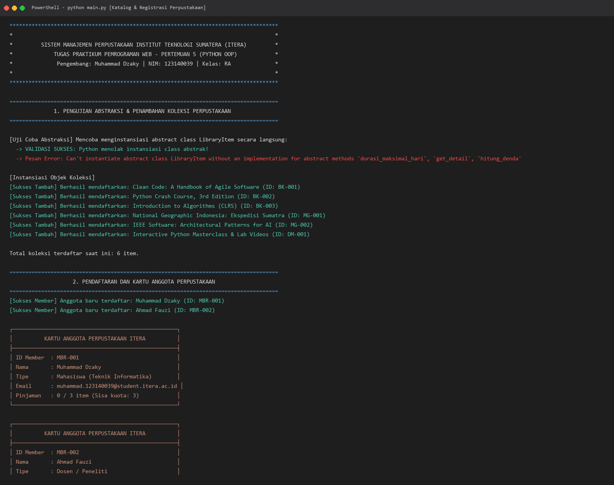
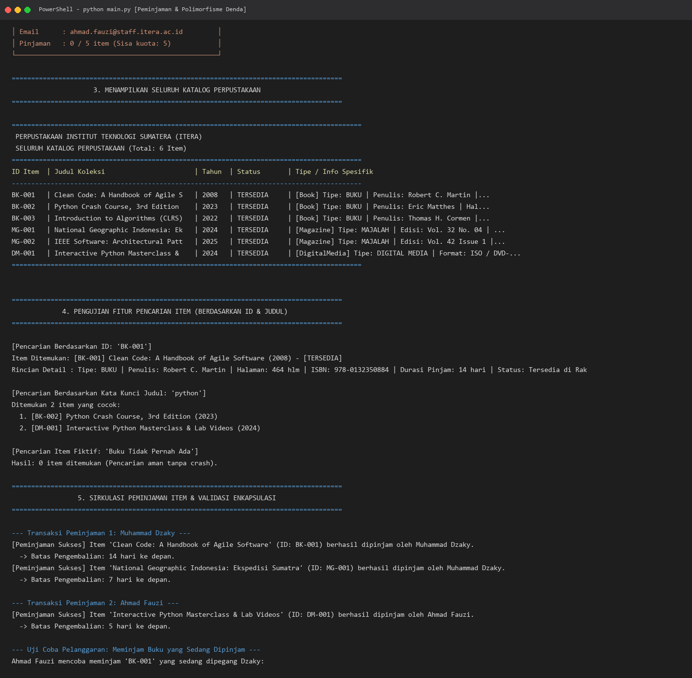

# Tugas Praktikum Pemrograman Web - Pertemuan 5
**Program Studi Teknik Informatika — Institut Teknologi Sumatera (ITERA)**

---

## 📌 Identitas Mahasiswa

| Informasi | Keterangan |
| :--- | :--- |
| **Nama Lengkap** | Muhammad Dzaky |
| **NIM** | 123140039 |
| **Mata Kuliah** | Pengembangan Aplikasi Web (PAW) |
| **Kelas Praktikum** | RA |
| **Modul Praktikum** | Pertemuan 5 (Python Object-Oriented Programming / OOP) |

---

## 📂 Struktur Berkas Proyek

```text
muhammaddzaky_123140039_pertemuan5/
│
├── latihan/                               
│   ├── mandiri/                            
│   │   ├── latihan_01_kasir.py             
│   │   ├── latihan_buku.py                 
│   │   ├── latihan_karyawan.py             
│   │   ├── latihan_notifikasi.py           
│   │   ├── latihan_storage.py              
│   │   └── latihan_truk.py                 
│   ├── 01_everything_is_object.py          
│   ├── 01_procedural_vs_oop.py             
│   ├── 02_class_object.py                  
│   ├── 03_inheritance.py                   
│   ├── 04_encapsulation.py                 
│   ├── 05_polymorphism.py                  
│   └── 06_abstract_class.py                
│
├── tugas_perpustakaan/                     
│   ├── library_item.py                     
│   ├── member.py                           
│   ├── library.py                          
│   └── main.py                             
│
├── Screenshoots/                           
│   ├── tugas_perpustakaan_part1.png        
│   ├── tugas_perpustakaan_part2.png        
│   └── latihan_polymorphism.png            
│
├── materi_05.txt                           
├── generate_screenshots.py                 
├── .gitignore                              
└── README.md                               
```

---

## 🏛️ Penerapan 4 Pilar Object-Oriented Programming (OOP)

Program Sistem Manajemen Perpustakaan dibangun dengan menerapkan empat pilar fundamental OOP secara terstruktur:

|  Pilar |  Class Penerapan |
| :--- | :--- |
| **Abstraction (Abstraksi)** | • `LibraryItem` *(Abstract Base Class dengan method abstract: `hitung_denda()`, `get_detail()`, dan `durasi_maksimal_hari()`)* |
| **Inheritance (Pewarisan)** | • `Book` *(Subclass turunan dari superclass `LibraryItem`)*<br>• `Magazine` *(Subclass turunan dari superclass `LibraryItem`)*<br>• `DigitalMedia` *(Subclass turunan dari superclass `LibraryItem`)* |
| **Encapsulation (Enkapsulasi)** | • `LibraryItem` *(Atribut private `__is_dipinjam`, `__id_peminjam` & `@property` getter)*<br>• `Member` *(Atribut private `__id_member`, `__nama`, `__daftar_pinjaman` & proteksi salinan list)*<br>• `Library` *(Atribut private `__koleksi`, `__daftar_member` & validasi akses method)* |
| **Polymorphism (Polimorfisme)** | • `Book` *(Implementasi polimorfik method `hitung_denda()` Rp 2.000/hari & `get_detail()`)*<br>• `Magazine` *(Implementasi polimorfik method `hitung_denda()` Rp 1.000/hari & `get_detail()`)*<br>• `DigitalMedia` *(Implementasi polimorfik method `hitung_denda()` Rp 3.000/hari & `get_detail()`)* |


## 📖 Deskripsi Alur Kerja Program Utama (`main.py`)

Skrip `main.py` menguji seluruh siklus hidup sistem otomasi perpustakaan melalui tahapan-tahapan pengujian berikut:

1. **Inisialisasi & Pembuktian Abstraksi**:
   * Sistem mencoba menginstansiasi class abstrak `LibraryItem` secara langsung dan membuktikan penolakan otomatis oleh Python (`TypeError`).
   * Menginstansiasi 6 koleksi konkrit yang terdiri atas 3 Buku (*Clean Code*, *Python Crash Course*, *CLRS Algorithms*), 2 Majalah (*National Geographic*, *IEEE Software*), dan 1 Media Digital (*Interactive Python Masterclass*).
2. **Pendaftaran Anggota (Member)**:
   * Mendaftarkan 2 anggota dengan tipe berbeda: `Muhammad Dzaky` (Mahasiswa, kuota maks 3 buku) dan `Ahmad Fauzi` (Dosen, kuota maks 5 buku).
   * Mencetak kartu keanggotaan terformat yang menampilkan kuota dan sisa peminjaman aktif.
3. **Penyajian Katalog Perpustakaan**:
   * Menampilkan seluruh inventaris koleksi perpustakaan dalam bentuk tabel rapi.
4. **Pencarian Koleksi (Search Engine)**:
   * Menguji pencarian berdasarkan kode unik ID item (`BK-001`).
   * Menguji pencarian substring judul tanpa terpengaruh huruf besar/kecil (pencarian `"python"` berhasil menemukan buku dan media digital).
   * Menguji pencarian kata kunci yang tidak ada, memastikan tidak terjadi program crash.
5. **Sirkulasi Peminjaman & Proteksi Enkapsulasi**:
   * Anggota meminjam koleksi yang diinginkan.
   * Menguji validasi keamanan: anggota lain mencoba meminjam item yang sedang berada di tangan anggota pertama, sistem menolak transaksi secara otomatis.
   * Menguji proteksi atribut private: akses langsung atribut `__is_dipinjam` ditolak dengan `AttributeError`.
6. **Penyaringan Katalog Ketersediaan**:
   * Menampilkan katalog dengan filter `hanya_tersedia=True`, membuktikan bahwa item yang sedang dipinjam otomatis hilang dari daftar rak tersedia.
7. **Pengembalian Item & Kalkulasi Denda Polimorfik**:
   * **Skenario Tepat Waktu**: Pengembalian dengan keterlambatan 0 hari menghasilkan denda Rp 0,00.
   * **Skenario Terlambat 5 Hari**:
     * Buku *Clean Code* terlambat 5 hari dikenakan denda $5 \times \text{Rp } 2.000 = \text{Rp } 10.000,00$.
     * Majalah *National Geographic* terlambat 5 hari dikenakan denda $5 \times \text{Rp } 1.000 = \text{Rp } 5.000,00$.
   * Menampilkan nota bukti pengembalian resmi perpustakaan.
8. **Status Akhir Perpustakaan**:
   * Memastikan seluruh item yang dikembalikan telah berstatus `TERSEDIA` kembali di rak katalog.

---


## 🚀 Panduan Menjalankan Program

### 1. Prasyarat Lingkungan
* Python versi **3.10** atau lebih baru (telah diuji pada Python 3.13.1).
* Terminal / Command Prompt / PowerShell.

### 2. Menjalankan Tugas Utama Perpustakaan
Buka terminal dan navigasikan ke direktori `tugas_perpustakaan`:

```powershell
# Berpindah ke direktori tugas perpustakaan
cd muhammaddzaky_123140039_pertemuan5/tugas_perpustakaan

# Menjalankan skrip utama
python main.py
```


## 📸 Tangkapan Layar Eksekusi Program (Screenshots)

### 1. Tugas Perpustakaan - Pendaftaran Koleksi, Anggota, dan Seluruh Katalog


### 2. Tugas Perpustakaan - Sirkulasi Peminjaman, Validasi Proteksi, dan Polimorfisme Denda


